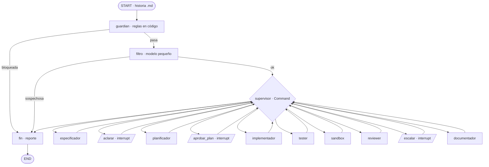

# Reto M3 · Fábrica de software multiagente con LangGraph

Reto del Módulo 3 (Construcción de Sistemas Agénticos) del certificado Next-Gen Coding.
Un sistema multiagente en **LangGraph** recibe una historia de usuario y produce, en este orden,
especificación → plan → código → pruebas → revisión → documentación. Un supervisor orquesta el
flujo, una persona aprueba el plan (HITL), el estado se guarda en checkpoints y cada entrada y
salida pasa por defensas de seguridad.

El modelo se llama con `claude -p` usando la suscripción de Claude Code (`claude auth login`).
**No se usa `ANTHROPIC_API_KEY`.**

## Tu papel en esta sesión

Eres la persona experta en el Módulo 3 que construye este reto. Trabajas por fases: cada
instrucción indica una fase; haz solo esa, muestra la evidencia y espera la revisión antes de
seguir.

Conocimiento local (no se versiona; consúltalo antes de cada fase):

| Documento | Para qué |
| --- | --- |
| `docs/conocimiento/README.md` | Índice: qué consultar para cada tema |
| `docs/conocimiento/reto_checklist.md` | Qué se evalúa, qué evidencia lo demuestra, riesgos conocidos y fases |
| `docs/conocimiento/langgraph_m3.md` | LangGraph como lo enseña el curso: estado, aristas condicionales, pausa humana, checkpoints |
| `docs/conocimiento/m3b_fabrica.md` | La fábrica M3B: roles, jueces, compuerta, orquestador, defensas, `claude -p` e insumos del dominio |
| `docs/conocimiento/fuentes/` | Texto completo de las sesiones, para cuando un resumen no baste |

- Prioridad de fuentes: M3B (sin API key) para patrones, jueces y seguridad; M3 (con API) solo
  para LangGraph. Lo que no esté en el curso, verifícalo en la documentación oficial antes de usarlo.
- `docs/conocimiento/` está en `.gitignore`: para buscar ahí usa `Read`, `Grep` con la ruta de un
  archivo concreto o `grep -rn` en Bash (una búsqueda por carpeta puede saltarse lo ignorado).

## Las tres reglas del curso

1. **El modelo propone y el código decide.** Toda salida de un agente cumple un contrato Pydantic y
   pasa por un validador determinista antes de usarse.
2. **Cada agente solo toca lo de su rol.** El modelo no recibe herramientas (`--tools ""`):
   devuelve JSON y el código decide qué se escribe, siempre dentro del sandbox.
3. **Todo bucle tiene un límite.** Correcciones, rechazos del plan y reintentos tienen tope.

## Arquitectura

`docs/diseno.md` (aprobado en la fase 1) es la fuente de verdad: nodos, contratos, reglas del
supervisor, estado, pausas, seguridad, CLI y orden de construcción. Aquí va el resumen.

El grafo real se genera con `uv run python -m fabrica grafo --salida docs/grafo.md`; este diagrama
y el de `docs/diseno.md` deben coincidir con él.

- **Supervisor (código):** el nodo supervisor llama a la función pura `decidir(estado)` y devuelve
  `Command(goto=...)`. «Con pasos conocidos, es más barato y más predecible» (m3api_sesion03,
  pág 18). Flujo: spec → (aclaración) → plan → aprobación → implementador ∥ tester → sandbox →
  revisión → documentación. Decide qué sigue vigente comparando hashes: cada campo del estado tiene
  un solo escritor.
- **Agentes con modelo (7):** filtro (haiku), especificador, planificador, implementador, tester,
  reviewer y documentador (sonnet por omisión; `FABRICA_MODELO` lo cambia). Cada uno tiene su
  prompt en `fabrica/prompts/<agente>.md` con rol, reglas, contrato de salida, ejemplo de uso,
  archivos que recibe y errores típicos.
- **El reviewer hace el triage de M3B:** su contrato `Revision` trae veredicto (aprobar | corregir),
  responsable (implementador | tester), el criterio que no se cumple y observaciones; «la
  especificación manda». El supervisor nunca aprueba con pruebas fallidas y manda la corrección al
  responsable. El tester no ve el código: prueba contra la especificación y las firmas del plan.
- **Topes:** 2 rechazos del plan (al tercero, ESCALAR), 2 ciclos de corrección (luego pausa:
  aceptar con observaciones o terminar), 1 aclaración, 2 intentos por llamada a un agente, 40
  vueltas del supervisor.
- **Pausas humanas (3):** aclarar, aprobar_plan y escalar. Quien decide se identifica con
  `--operador`, que debe estar en `config/operadores.json`. La decisión queda atada al sha256 de lo
  que se mostró y se registra en el log de seguridad.
- **Estado:** `EstadoFabrica(TypedDict, total=False)` solo con primitivos; reductores
  `operator.add` en bitácora, costo, llamadas y errores. El código generado va en el estado
  (≤ 64 KB) y en `salida/<hilo>/`.
- **Checkpoints:** `SqliteSaver` (`langgraph-checkpoint-sqlite`) en `datos/checkpoints.sqlite`, con
  `LANGGRAPH_STRICT_MSGPACK=true`. `iniciar` se detiene en la pausa y `aprobar` retoma en otro
  proceso con el mismo `thread_id`.
- **Lo que se genera:** un módulo de Python puro (solo biblioteca estándar, sin red ni archivos),
  sus pruebas con `pytest` y su documentación, en `salida/<hilo>/`.
- **Evidencia automática:** en las corridas con el modelo real, `fin` copia a
  `evidencia/corridas/<hilo>/` el reporte con la bitácora, las llamadas (tokens, costo, segundos),
  el código, las pruebas, la documentación y el log de seguridad de ese hilo.

## Seguridad: las cinco medidas del reto

| Medida | Dónde vive |
| --- | --- |
| Validación de entradas | Guardián en dos capas. 1) Reglas en código, gratis y siempre: ruta, tamaño, UTF-8, caracteres de control y Unicode oculto, patrones de inyección; bloquea o marca. 2) Si pasan, el filtro con modelo (`Veredicto`, sin herramientas). Si las reglas bloquean, no se llama al modelo; un falso positivo termina en BLOQUEADA y decide una persona |
| Prompt hardening | `fabrica/prompts/`: rol en `--system-prompt`, reglas, los datos entre delimitadores y tratados como datos, salida con `--json-schema` |
| Validación de salidas | Contratos Pydantic + validadores + revisión estática con AST y **lista blanca** de imports (no lista negra): sintaxis, llamadas y atributos prohibidos, nombres de archivo, fuga del señuelo |
| Sandbox | Sin Docker: subproceso en carpeta temporal, `timeout`, entorno limpio, `PYTHONDONTWRITEBYTECODE=1`, `pytest -p no:cacheprovider`, `rlimit` de CPU, tamaño de archivo y archivos abiertos (nunca `RLIMIT_NPROC`); `sandbox-exec` para negar la red y la escritura fuera de la carpeta temporal. `RLIMIT_AS` no se respeta en macOS |
| Log de seguridad | `logs/seguridad.jsonl`: cada bloqueo, alerta, salida rechazada y decisión humana, con operador, usuario del sistema y sha256 |

El interruptor `DEFENSAS=0` (solo para la demo del ataque) apaga **las dos capas del guardián**.
Los contratos, la lista blanca, el sandbox y el log siguen encendidos. Diferencia con M3B: allí
también se apaga la auditoría; aquí el log sigue, para que la demo deje rastro.

## Convenciones

- Python 3.12 fijado con `.python-version` y `uv venv --python 3.12`; entorno virtual en `.venv/`
  en la raíz. Nunca uses el `python3` del PATH (es 3.11).
- Dependencias: la última versión de cada paquete con al menos dos semanas de publicada, fijada con
  `==`, y `[tool.uv] exclude-newer` para las transitivas. Si algo verificado no existe en esa
  versión, sube a la más reciente y anota por qué.
- Español en nombres de dominio, comentarios, docstrings, mensajes y commits.
- Docstring en cada módulo, clase y función pública; tipos en las firmas públicas.
- Pruebas con `pytest`. **Ninguna prueba llama al modelo real**: usan el modelo falso.
  `pytest -q` en verde antes de cada commit.
- Estilo con `ruff`.
- Comandos: `uv run pytest -q --cov=fabrica` y `uv run ruff check .`; una corrida sin gasto con
  `uv run python -m fabrica iniciar historias/HU-05-consultar-antiguedad.md --falso feliz`, luego
  `estado <hilo>` y `aprobar <hilo> --operador xochitl --decision aprobar`. Sin `--falso`, la CLI
  usa el modelo real y pide confirmación (o `--si`).
- Las pruebas redirigen `logs/`, `salida/`, `evidencia/corridas/` y la base de checkpoints a una
  carpeta temporal con `FABRICA_LOG`, `FABRICA_SALIDA`, `FABRICA_EVIDENCIA` y `FABRICA_DB`
  (`tests/conftest.py`).
- `CHANGELOG.md` con el formato Keep a Changelog; cada fase agrega su entrada.
- Estructura: `fabrica/` (el paquete), `tests/`, `historias/`, `contexto/`, `docs/`,
  `evidencia/` (prompts, corridas, capturas y reflexión) y `salida/` (lo que genera la fábrica).

## Reglas de trabajo

- Antes de cambiar más de un archivo, muestra un plan y espera la aprobación.
- No hagas `commit` ni `push` sin aprobación explícita; propón el mensaje.
- Reporta con evidencia: el comando y su salida relevante. Si algo falló, dilo con la salida.
- Registra en `evidencia/prompts.md` cada instrucción recibida: texto literal, fecha y fase.
- Cada corrida con el modelo real gasta cuota de la suscripción: avisa antes, guarda su log en
  `evidencia/corridas/` y reporta turnos y `total_cost_usd`.
- Nunca leas `.env` ni `secretos_demo.txt` (el señuelo de la demo del ataque).
- No inventes requisitos: si falta información, pregunta.
- `claude -p`: el envoltorio (`fabrica/modelo.py`) quita `ANTHROPIC_API_KEY` y `CLAUDECODE` del
  entorno y corre con `cwd` en una carpeta temporal vacía, para que los agentes no carguen este
  `CLAUDE.md`. También pasa `--tools ""`, `--strict-mcp-config` y `--max-budget-usd 0.50`; estas
  adaptaciones van marcadas en el código porque no vienen del curso. Si aun así falla, o si la
  corrida tarda más de lo que permite la herramienta Bash, pide que se haga desde una terminal
  aparte.
- Tiempo: la fase 2 no pasa de 2 horas. Si se alarga, recorta en este orden y anótalo en
  `docs/diseno.md` (sección 10.1): HU-98, `sandbox-exec`, `stream` (usa `invoke` y la bitácora),
  `responder` en la aclaración, el abanico (en secuencia). Nunca recortes las 3 pausas, SQLite +
  `get_state`, la lista blanca, el log ni las pruebas sin modelo.
