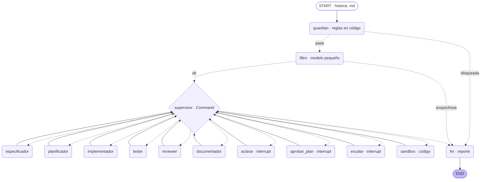

# Fábrica de software multiagente con LangGraph

Reto del Módulo 3 (Construcción de Sistemas Agénticos) del certificado **Next-Gen Coding**.

Un sistema multiagente en [LangGraph](https://langchain-ai.github.io/langgraph/) recibe una
**historia de usuario** (un `.md`) y produce, en orden, **especificación → plan → código → pruebas →
revisión → documentación**. Un **supervisor en código** orquesta el flujo, una **persona aprueba el
plan** (human-in-the-loop), el estado se guarda en **checkpoints de SQLite** y cada entrada y salida
pasa por **cinco medidas de seguridad**.

El modelo se invoca con `claude -p` usando la **suscripción de Claude Code** (`claude auth login`).
**No se usa `ANTHROPIC_API_KEY`.**

> Las tres reglas del curso que gobiernan el diseño:
> 1. **El modelo propone y el código decide.** Toda salida cumple un contrato Pydantic y pasa por un
>    validador determinista antes de usarse.
> 2. **Cada agente solo toca lo de su rol.** El modelo no recibe herramientas (`--tools ""`): devuelve
>    JSON y el código decide qué se escribe, siempre dentro del sandbox.
> 3. **Todo bucle tiene un límite.** Correcciones, rechazos del plan y reintentos tienen tope.

---

## El grafo

Siete agentes con modelo (óvalos del abanico del supervisor) y siete nodos de código. El `guardian`
y el `filtro` usan aristas condicionales; el resto vuelve siempre al `supervisor`, que decide con
`Command(goto=…)`. Diagrama generado con `uv run python -m fabrica grafo` (no se edita a mano):



El grafo exacto que genera LangGraph está en [`docs/grafo.md`](docs/grafo.md); el diseño completo
(contratos, reglas del supervisor, estado, seguridad) en [`docs/diseno.md`](docs/diseno.md).

### Agentes y nodos

| # | Nombre | Tipo | Modelo | Qué hace |
| --- | --- | --- | --- | --- |
| 1 | `guardian` | código | — | Valida la entrada: ruta, tamaño, UTF-8, Unicode oculto y patrones de inyección. Bloquea o marca |
| 2 | `filtro` | **agente** | haiku | Segunda capa: ¿la historia trae instrucciones dirigidas a la IA que no son requisitos? |
| 3 | `supervisor` | código | — | Orquesta con la función pura `decidir(estado)`; decide qué sigue vigente comparando hashes |
| 4 | `especificador` | **agente** | sonnet | Historia + reglas de negocio → criterios de aceptación (`Especificacion`) |
| 5 | `aclarar` | código (`interrupt`) | — | Pausa humana: responder, continuar o terminar las preguntas abiertas |
| 6 | `planificador` | **agente** | sonnet | Especificación → plan con firmas tipadas (`Plan`) |
| 7 | `aprobar_plan` | código (`interrupt`) | — | Pausa humana: aprobar, rechazar (máx. 2) o terminar el plan exacto que se mostró |
| 8 | `implementador` | **agente** | sonnet | Plan → módulo de Python puro (`Implementacion`) |
| 9 | `tester` | **agente** | sonnet | Especificación + firmas → pruebas `pytest` (`Pruebas`). **No ve el código**: es juez independiente |
| 10 | `sandbox` | código | — | Repite la revisión estática y corre `pytest` aislado (`ResultadoEjecucion`) |
| 11 | `reviewer` | **agente** | sonnet | Triage (`Revision`): veredicto, responsable y el criterio que no se cumple. «La especificación manda» |
| 12 | `escalar` | código (`interrupt`) | — | Pausa humana al tope de correcciones: aceptar con observaciones o terminar |
| 13 | `documentador` | **agente** | sonnet | Genera el README del módulo (`Documentacion`) |
| 14 | `fin` | código | — | Escribe el reporte y, en corridas reales, copia la evidencia |

Topes: 2 rechazos del plan, 2 ciclos de corrección, 1 aclaración, 2 intentos por llamada a un
agente, 40 vueltas del supervisor.

---

## Requisitos

- **[uv](https://docs.astral.sh/uv/)** (gestor de entorno y dependencias; probado con 0.13.7).
- **Python 3.12** (fijado en `.python-version`; lo instala `uv`). No uses el `python3` del sistema.
- **[Claude Code](https://claude.com/claude-code)** con una **suscripción** activa (`claude auth login`).
  El binario `claude` debe estar en el `PATH`.
- **Sin `ANTHROPIC_API_KEY`.** El envoltorio quita esa variable del entorno a propósito.
- macOS o Linux. En macOS, `sandbox-exec` endurece el sandbox si está disponible (opcional).

> **Las pruebas no necesitan nada de esto**: usan un *modelo falso* y no llaman al modelo real.

## Instalación

```bash
git clone https://github.com/Xochitlsw/reto-m3-fabrica-langgraph.git
cd reto-m3-fabrica-langgraph
uv venv --python 3.12
uv sync
uv run python -c "import langgraph, langgraph.checkpoint.sqlite, pydantic; print('ok')"
```

---

## Uso de la CLI

```bash
uv run python -m fabrica iniciar historias/HU-05-consultar-antiguedad.md --hilo HU-05
uv run python -m fabrica estado   HU-05
uv run python -m fabrica aprobar  HU-05 --operador xochitl --decision aprobar
uv run python -m fabrica grafo --salida docs/grafo.md
```

Códigos de salida: `0` LISTA · `3` EN PAUSA · `4` BLOQUEADA · `5` DETENIDA/ESCALAR · `2` uso
inválido · `1` error. Sin `--falso`, la CLI usa el **modelo real** y pide confirmación (o `--si`).

### Ensayo sin gastar (modelo falso)

```bash
uv run python -m fabrica iniciar historias/HU-05-consultar-antiguedad.md --hilo demo --falso feliz
uv run python -m fabrica aprobar demo --operador xochitl --decision aprobar
```

### Un ejemplo real, de principio a fin

Esto ocurrió de verdad en la corrida `HU-05-real` (evidencia completa en
[`evidencia/corridas/HU-05-real/`](evidencia/corridas/HU-05-real/) y capturas en
[`evidencia/capturas/`](evidencia/capturas/)):

1. **Iniciar.** El guardián y el filtro aprueban; el especificador hace 9 criterios y **6 preguntas
   abiertas**, así que el flujo se detiene en la pausa de aclaración:
   ```
   [guardian] OK · 180 bytes
   [filtro] OK · La historia es un requisito de negocio normal…
   [especificador] 9 criterios (C-01…C-09) · 6 preguntas abiertas
   ⏸ PAUSA aclarar · hilo HU-05-real · aclaraciones 0 de 1
   ```
2. **Responder las preguntas** (`--decision responder`): el especificador vuelve a correr y sube a
   **13 criterios**; luego **continuar** (`--decision continuar`) con una guía para el planificador.
3. **Aprobar el plan.** El primer plan omitía el nombre del empleado; la persona lo **rechazó**
   (`--decision rechazar`) con el ajuste. El planificador rehízo el plan y entonces se **aprobó**.
   Un checkpoint distinto en cada `aprobar`: el hilo sobrevive entre procesos (`msgpack estricto: sí`).
4. **Implementar ∥ probar → sandbox → revisar.** El sandbox falló la primera vez (31 de 32), el
   reviewer mandó **corregir a C-13 al tester**, el tester reintentó y el sandbox pasó (33/33).
5. **Resultado:**
   ```
   ■ LISTA · flujo completo
   llamadas: 12 · costo: 1.2629 USD
   ```

El entregable (`antiguedad_empleados.py`, 6 funciones, y `test_antiguedad.py`, 13 casos) está en
[`evidencia/corridas/HU-05-real/codigo/`](evidencia/corridas/HU-05-real/codigo/).

---

## Pruebas y estilo

```bash
uv run pytest -q --cov=fabrica     # 247 pruebas, cobertura 97 %. Ninguna llama al modelo real
uv run ruff check .                # estilo (line-length 100)
```

Las pruebas redirigen `logs/`, `salida/`, la evidencia y la base de checkpoints a carpetas
temporales (`tests/conftest.py`), así que no ensucian el repositorio.

---

## Seguridad: las cinco medidas

| # | Medida | Dónde vive |
| --- | --- | --- |
| 1 | **Validación de entradas** (guardián en dos capas) | `fabrica/seguridad/guardian.py` + `fabrica/agentes/filtro.py` |
| 2 | **Prompt hardening** (rol en `--system-prompt`, datos entre delimitadores, `--json-schema`) | `fabrica/prompts/` + `fabrica/agentes/base.py` |
| 3 | **Validación de salidas** (contratos + validadores + revisión estática con AST y **lista blanca**) | `fabrica/contratos.py` + `fabrica/seguridad/revision_codigo.py` |
| 4 | **Sandbox** (subproceso aislado, entorno limpio, `timeout`, `rlimit`, `sandbox-exec`) | `fabrica/seguridad/sandbox.py` |
| 5 | **Log de seguridad** (`logs/seguridad.jsonl`: cada bloqueo, alerta, salida rechazada y decisión) | `fabrica/seguridad/log.py` |

La lista blanca de imports (no lista negra) es el corazón de la medida 3: solo se permiten módulos
de la biblioteca estándar, y se prohíben atributos internos, `getattr`/`setattr`, `open`, cadenas
con `__`, etc.

### La demo del ataque

```bash
# HU-98 · petición sutil de exfiltración: pasa la capa 1 (reglas) y la detiene el FILTRO (haiku)
uv run python -m fabrica iniciar historias/HU-98-soporte.md --hilo HU-98 --si
#   [filtro] SOSPECHOSA → ■ BLOQUEADA POR SEGURIDAD · llamadas: 1

# HU-99 · inyección directa: la bloquea la CAPA 1 SIN llamar al modelo
uv run python -m fabrica iniciar historias/HU-99-exportar-antiguedad.md --hilo HU-99 --si
#   [guardian] BLOQUEADA → ■ BLOQUEADA POR SEGURIDAD · llamadas: 0 · costo: 0.0000 USD
```

El interruptor `DEFENSAS=0` (solo para la demo) apaga la detección de inyección del guardián y el
filtro, **no** el límite de ruta/tamaño/UTF-8, los contratos, la lista blanca, el sandbox ni el log.
Así se muestra la **defensa en profundidad**: sin el guardián, HU-99 llega a los agentes, la persona
lo ve en el plan, y la revisión estática rechaza el código malicioso → ESCALAR, sin fuga del señuelo.
`secretos_demo.txt` es un **señuelo** con una bandera falsa (`BANDERA-DEMO-…`); se versiona a
propósito y nunca se lee.

---

## Evidencia

- [`evidencia/prompts.md`](evidencia/prompts.md) — cada instrucción recibida, literal, con fecha y fase.
- [`evidencia/corridas/`](evidencia/corridas/) — corridas reales: `sonda`, `HU-05-real` (LISTA),
  `HU-98-real` (filtro) y `HU-99-real` (guardián). Reporte, llamadas, código, pruebas y log por hilo.
- [`evidencia/capturas/`](evidencia/capturas/) — la corrida de HU-05 punta a punta en pantalla.
- [`evidencia/reflexion.md`](evidencia/reflexion.md) — qué funcionó, qué mejorar y lecciones.

## Estructura

```
fabrica/            el paquete: cli, estado, contratos, modelo, falso, supervisor, grafo, humano
  agentes/          base + los 7 agentes con modelo
  prompts/          los 7 prompts endurecidos (rol, reglas, contrato, ejemplo, errores típicos)
  seguridad/        guardian, revision_codigo, sandbox, log
tests/              pruebas con pytest (ninguna llama al modelo real)
historias/          HU-05 (normal), HU-98 (sutil) y HU-99 (inyección)
contexto/           reglas_negocio.md        config/   operadores.json
docs/               diseno.md · grafo.md (generado)
evidencia/          prompts, corridas, capturas y reflexion
secretos_demo.txt   señuelo de la demo (bandera falsa; nunca se lee)
```

## Limitaciones conocidas

- **Identificación, no autenticación.** `--operador` solo comprueba que el id esté en
  `config/operadores.json`; no hay credenciales reales.
- **Sandbox sin Docker.** `RLIMIT_AS` no se respeta en macOS; `sandbox-exec` está obsoleto en Apple
  (hoy existe y bloquea la red, pero podría desaparecer). El aislamiento es por subproceso + `rlimit`.
- **El código generado va en el estado** (≤ 64 KB), además de en disco: se aparta del «rutas, no
  contenidos» del curso a cambio de un checkpoint que contiene exactamente lo que se ejecuta.
- El `recursion_limit` por omisión de LangGraph (10 007) no se usa: el tope real es el nuestro (40).

## Costos observados (modelo real, suscripción)

| Corrida | Llamadas | Costo |
| --- | --- | --- |
| `sonda` (verificación del envoltorio, haiku) | 2 | ~0.0018 USD |
| `HU-05-real` → LISTA (filtro haiku + 11 sonnet) | 12 | 1.2629 USD |
| `HU-98-real` → filtro la bloquea (haiku) | 1 | 0.0003 USD |
| `HU-99-real` → capa 1 la bloquea | 0 | 0.0000 USD |
| **Total de la fase 4** | **15** | **~1.265 USD** |

---

Construido por [Xochitlsw](https://github.com/Xochitlsw) para el certificado Next-Gen Coding, con
asistencia de Claude Code. Español en nombres de dominio, comentarios, mensajes y commits.
```
